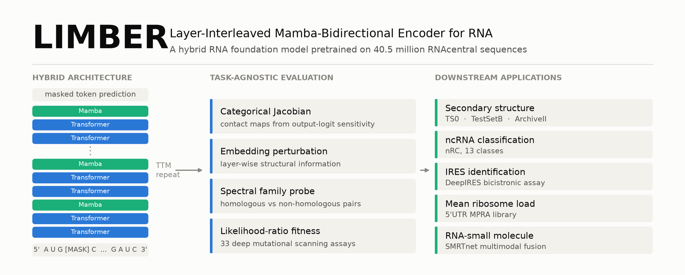
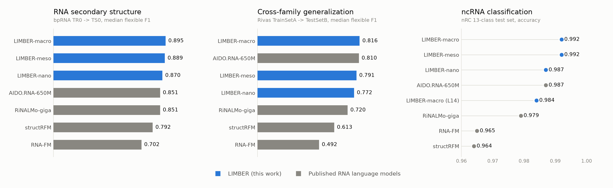
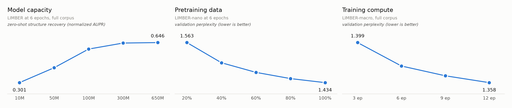

<div align="center">

<picture>
  <source media="(prefers-color-scheme: dark)" srcset="assets/limber_banner_dark.png">
  
</picture>

<h3>A Hybrid RNA Foundation Model for Predicting and Understanding<br>RNA Structure and Function</h3>

<!-- TODO: add the bioRxiv DOI once the preprint is live -->
[](#)
[](https://huggingface.co/Ziyao1010/LIMBER)
[](https://www.python.org/)
[](https://pytorch.org/)

**Ziyao Wang**<sup>1†</sup> · **Yunrui Qiu**<sup>2†\*</sup> · Yexiao He<sup>1</sup> · Isabel Thompson<sup>2</sup> · Hongli Wang<sup>2</sup> · Adam Porter<sup>3</sup> · **Ang Li**<sup>1\*</sup>

<sub><sup>1</sup>Dept. of Electrical and Computer Engineering, University of Maryland, College Park · <sup>2</sup>Dept. of Chemistry and Biochemistry, University of Notre Dame · <sup>3</sup>Dept. of Computer Science, University of Maryland, College Park<br><sup>†</sup>Equal contribution · <sup>\*</sup>Corresponding authors</sub>

[**Paper**](#) · [**Models**](https://huggingface.co/Ziyao1010/LIMBER) · [**Quick start**](#quick-start) · [**Results**](#results) · [**Zero-shot framework**](#what-pretraining-alone-produces) · [**Scaling**](#scaling-behaviour) · [**Reproduce**](#reproducing-the-paper)

</div>

---

## Overview

Non-coding RNAs are more diverse and more abundant than messenger RNAs, yet their
experimentally resolved structures and functional annotations remain scarce. Self-supervised
pretraining offers a way across that gap: given enough unlabeled sequence, an RNA language
model can learn the evolutionary, structural and functional constraints that shape RNA.

**LIMBER** (Layer-Interleaved Mamba–Bidirectional Encoder for RNA) is a hybrid RNA foundation
model that interleaves bidirectional Transformer attention with Mamba selective state-space
layers in a repeating **Transformer–Transformer–Mamba (TTM)** pattern, pretrained by masked
language modeling on **40,498,819 RNAcentral sequences**. Self-attention captures direct
couplings between arbitrary positions — the long-range coevolutionary signal that base pairing
leaves in a sequence. Mamba contributes a complementary prior for ordered structure: RNA is a
directional polymer, and its recurring motifs carry ordered signatures that attention alone does
not impose. Interleaving the two gives the model both.

Alongside the model, we release a **unified, task-agnostic evaluation and interpretation
framework**. It probes a pretrained RNA language model for secondary structure, sequence
identity and mutational fitness without any fine-tuning, so what the model learned during
pretraining can be measured directly rather than inferred from a downstream score. We use it to
separate the contributions of architecture, model size, pretraining-data scale and training
compute across a panel of **10 LIMBER variants plus size-matched pure-Transformer and
pure-Mamba models** trained under identical settings — every one of them released here.

## Highlights

- **Leading secondary-structure prediction.** LIMBER-macro reaches a median flexible F1 of
  **0.895** on the bpRNA TS0 benchmark and **0.816** on the structurally disjoint Rivas TestSetB,
  ahead of RiNALMo-giga, AIDO.RNA-650M, structRFM and RNA-FM fine-tuned under an identical protocol.
- **Near-ceiling ncRNA classification.** **99.2%** accuracy on the 13-class nRC benchmark, with
  the best AUROC, AUPRC, MCC and F1 of every model tested.
- **A zero-shot framework that needs no labels at all.** Four probes read structure, evolutionary
  relatedness and mutational fitness straight out of a pretrained model — no fine-tuning, no
  auxiliary probe to train. Categorical-Jacobian contact maps pulled directly from LIMBER-macro
  reach **0.870 normalized AUPR on CRW and 0.857 on tRNAdb** without ever seeing a labelled
  structure, and beat the RNAstructure and ViennaRNA thermodynamic predictors on most datasets.
- **Intermediate layers are enough.** A LIMBER-macro truncated to its first 14 layers — about 43%
  of the parameters — still classifies at **98.4%**, outperforming RiNALMo-giga at a fraction of
  the cost. The task-agnostic framework predicted this before any fine-tuning was run.
- **Transfers beyond non-coding RNA.** Strong results on IRES identification, 5′UTR mean ribosome
  load regression and RNA–small-molecule interaction prediction, despite pretraining on a
  predominantly non-coding corpus.
- **A controlled architecture comparison.** Pure-Transformer and pure-Mamba models at 100M, 300M
  and 650M parameters, trained on the same data with the same optimizer, isolate what the hybrid
  design actually contributes.
- **Scaling laws that differ by capability.** With data, optimizer and corpus held fixed across
  every variant, the three axes separate cleanly. Model capacity is the strongest lever
  (zero-shot structure recovery **0.301 → 0.646** from 10M to 650M); data saturates around half
  the corpus; doubling compute buys the least. Fitness prediction keeps climbing with size while
  RNA-type discrimination moves the *other* way — capabilities scale non-uniformly and appear to
  compete for shared capacity.
- **Fully open.** Every checkpoint, every probe, every downstream pipeline.

## Results

<picture>
  <source media="(prefers-color-scheme: dark)" srcset="assets/limber_benchmarks_dark.png">
  
</picture>

Every baseline below is fine-tuned and evaluated by us under the same protocol as LIMBER, so the
RNA encoder is the only variable.

### RNA secondary structure

Flexible F1 (±1 nt), RiNALMo fine-tuning protocol with a residual convolutional pairwise head.

| Model | TS0 median | TS0 mean | TestSetB median | TestSetB mean | ArchiveII inter-family |
|---|---|---|---|---|---|
| **LIMBER-macro (650M)** | **0.895** | **0.795** | **0.816** | **0.757** | 0.809 |
| **LIMBER-meso (300M)** | 0.889 | 0.788 | 0.791 | 0.733 | 0.773 |
| **LIMBER-nano (100M)** | 0.870 | 0.770 | 0.772 | 0.704 | 0.736 |
| AIDO.RNA-650M | 0.851 | 0.761 | 0.810 | 0.738 | **0.819** |
| RiNALMo-giga (650M) | 0.851 | 0.760 | 0.720 | 0.667 | 0.789 |
| structRFM (86M) | 0.792 | 0.699 | 0.613 | 0.580 | 0.659 |
| RNA-FM (100M) | 0.702 | 0.633 | 0.492 | 0.506 | 0.401 |

TS0: trained on TR0 (10,814), validated on VL0 (1,300), tested on TS0 (1,305). TestSetB: trained
on Rivas TrainSetA, tested on 430 Rfam-derived sequences with structures distinct from training.
ArchiveII: leave-one-family-out over 9 families, mean F1 pooled across all 1,188 sequences.
At matched scale LIMBER-nano beats RNA-FM and structRFM on every one of the nine held-out families.

### ncRNA classification — nRC, 13 classes, 2,600 test sequences

| Model | Accuracy | MCC | Macro F1 | AUROC | AUPRC |
|---|---|---|---|---|---|
| **LIMBER-macro (650M)** | **0.9919** | **0.9913** | **0.9919** | **0.9996** | **0.9982** |
| **LIMBER-meso (300M)** | 0.9915 | 0.9908 | 0.9916 | 0.9989 | 0.9943 |
| **LIMBER-nano (100M)** | 0.9865 | 0.9854 | 0.9866 | 0.9988 | 0.9933 |
| **LIMBER-macro, first 14 layers** | 0.9842 | 0.9829 | 0.9842 | 0.9995 | 0.9968 |
| AIDO.RNA-650M | 0.9865 | 0.9854 | 0.9865 | 0.9994 | 0.9964 |
| RiNALMo-giga (650M) | 0.9792 | 0.9775 | 0.9792 | 0.9991 | 0.9939 |
| RNA-FM (100M) | 0.9650 | 0.9621 | 0.9648 | 0.9985 | 0.9905 |
| structRFM (86M) | 0.9638 | 0.9609 | 0.9638 | 0.9970 | 0.9851 |

### IRES identification — DeepIRES benchmark, 1,853 test sequences

| Model | AUROC | AUPRC | F1 | MCC | Accuracy |
|---|---|---|---|---|---|
| **LIMBER-macro (650M)** | 0.829 | 0.431 | 0.492 | 0.436 | **0.899** |
| **LIMBER-meso (300M)** | 0.822 | 0.450 | 0.441 | 0.376 | 0.844 |
| **LIMBER-nano (100M)** | 0.815 | 0.397 | 0.397 | 0.328 | 0.813 |
| RiNALMo-giga (650M) | **0.861** | 0.474 | **0.505** | **0.451** | 0.866 |
| AIDO.RNA-650M | 0.822 | 0.426 | 0.432 | 0.363 | 0.853 |
| structRFM (86M) | 0.783 | 0.288 | 0.346 | 0.269 | 0.776 |
| RNA-FM (100M) | 0.776 | 0.295 | 0.358 | 0.282 | 0.791 |
| DeepIRES (task-specific) | 0.859 | **0.544** | 0.433 | 0.383 | 0.806 |
| IRESfinder (k-mer) | 0.650 | 0.177 | 0.234 | 0.132 | 0.521 |

On the 104-sequence independent benchmark LIMBER-macro takes the **highest AUPRC of any model,
0.852**, ahead of the task-specific DeepIRES.

### Mean ribosome load — 5′UTR MPRA, R²

| Model | Random test (7,600) | Human test (7,600) |
|---|---|---|
| **LIMBER-macro (650M)** | 0.891 | 0.826 |
| **LIMBER-nano (100M)** | 0.882 | 0.819 |
| **LIMBER-meso (300M)** | 0.879 | 0.818 |
| RiNALMo-giga (650M) | **0.911** | 0.843 |
| AIDO.RNA-650M | 0.903 | **0.844** |
| structRFM (86M) | 0.736 | 0.694 |
| RNA-FM (100M) | 0.712 | 0.719 |

LIMBER-nano matches models six times its size and leaves the other ~100M models far behind.

### RNA–small-molecule interactions

Dropping each RNA encoder into the [SMRTnet](https://doi.org/10.1038/s41587-025-02942-z)
multimodal framework — chemical language model, graph-attention encoder and co-attention fusion
all unchanged — and fine-tuning end-to-end over five-fold cross-validation × three seeds,
LIMBER-macro surpasses RiNALMo-giga and AIDO.RNA-650M on held-out AUROC, and LIMBER-nano
outperforms RNA-FM, structRFM and SMRTnet's own RNASwan-seq encoder. On the 2,011-interaction
external benchmark, scored by sliding-window ensembling without prior knowledge of the binding
pocket, both LIMBER variants hold up across accuracy, precision, recall, AUROC and AUPRC.

## What pretraining alone produces

Downstream scores are a blunt instrument for judging a foundation model: they confound what the
encoder knows with how well a task head was tuned on a small labelled set. So we built a
**unified, task-agnostic framework** that interrogates a pretrained model directly — no labels,
no fine-tuning, no auxiliary probe to train. Four complementary views, across structure,
evolution and function.

| Probe | Question it answers | Script |
|---|---|---|
| **Categorical Jacobian** | Can the output logits' sensitivity to every single-nucleotide substitution reconstruct the native contact map? An end-to-end, full-network read, unlike attention-head picking | `scripts/jacobian_ss_eval.py`, `scripts/extract_contacts_categorical_jacobian.py` |
| **Embedding perturbation** | Where in the stack does that structural signal live? Same substitutions, but measured in each layer's hidden states — one contact map per layer | `scripts/extract_contacts_embedding_perturb.py` |
| **Spectral family probe** | Do the representations separate homologous from non-homologous sequence pairs? FFT spectral features per layer, scored by distribution overlap | `scripts/extract_family_cls_full.py`, `scripts/nrc_zeroshot.py` |
| **Likelihood-ratio fitness** | Do wild-type-conditioned log-likelihood ratios track measured mutational effects? One forward pass per wild type | `scripts/make_fig_fitness_landscape.py` |
| **Layer ablation** | Which layers actually matter? Perplexity, contact recovery and fitness correlation with one layer removed, or the encoder truncated | `scripts/layer_importance.py` |

### Secondary structure, read straight out of the model

Categorical-Jacobian contact maps extracted from LIMBER-macro with no fine-tuning whatsoever,
scored by normalized AUPR (1 = perfect, 0 = random) across the seven source datasets of
bpRNA-1m(90):

| Source | CRW | tRNAdb | RNP | tmRNA | SRP | RFAM | PDB | macro mean |
|---|---|---|---|---|---|---|---|---|
| *n* | 3,300 | 207 | 253 | 339 | 348 | 1,000 | 329 | 5,776 |
| **Normalized AUPR** | **0.870** | **0.857** | **0.741** | **0.675** | **0.625** | **0.460** | **0.294** | **0.646** |

Over the full **26,707-sequence** benchmark, LIMBER-macro beats RNA-FM, structRFM, RNAErnie and
the LucaOne family in nearly every RNA category, beats the RNAstructure and ViennaRNA
thermodynamic predictors in most, and is competitive with RiNALMo-giga and the AIDO family. At
matched scale LIMBER-nano generally outperforms RiNALMo-mega. No model saw a single labelled
structure.

### Evolutionary and functional signal

On **33 deep mutational scanning assays** from RNAGym — 862,376 variants spanning aptamer–protein
binding, ribozyme self-cleavage, self-aminoacylation, template-directed polymerization, tRNA
growth and suppressor activity, and pre-mRNA splicing — wild-type-conditioned log-likelihood
ratios from LIMBER-macro give the leading overall Spearman correlation, with a clear margin on
ribozymes. On family discrimination over Rfam 15.1 seed alignments and ArchiveII (100,000
homologous and 100,000 non-homologous pairs each), LIMBER variants achieve the best family-level
separation of every RNA language model tested.

### Information is organized hierarchically, not monotonically

Layer ablation and embedding perturbation together show that **deeper is not uniformly better**.
Structural information accumulates in the final two or three layers, and ablating the Mamba
layers near the start and end of the encoder damages contact recovery and fitness correlation the
most. Yet the middle layers that contribute least to structure carry the *sharpest* discrimination
between RNA families. Which layer is most useful depends on the biological question — and that is
a practical result, not just an interpretability one: it is what led us to truncate LIMBER-macro
to its first 14 layers for classification and keep 98.4% accuracy at ~43% of the parameters.

## Scaling behaviour

<picture>
  <source media="(prefers-color-scheme: dark)" srcset="assets/limber_scaling_dark.png">
  
</picture>

Because every variant was pretrained by us on the same corpus with the same optimizer, the three
scaling axes can be separated cleanly — something published RLM comparisons cannot do, since they
differ in parameters, data and budget all at once.

**Model capacity is the strongest lever.** Across 10M → 650M parameters at fixed data and budget,
perplexity, zero-shot structure recovery, family discrimination and fitness prediction all improve
broadly monotonically. Structure recovery rises steeply through the small and intermediate scales,
then flattens:

| Parameters | 10.2M | 49.3M | 91.7M | 303.6M | 664.3M |
|---|---|---|---|---|---|
| Zero-shot structure (norm. AUPR) | 0.301 | 0.429 | 0.590 | 0.642 | 0.646 |
| Validation perplexity | 1.604 | 1.497 | 1.434 | 1.398 | 1.377 |

**Data helps most up to about half the corpus.** Pretraining LIMBER-nano on 20/40/60/80/100% of
the 40.5M sequences, the largest gains land early; beyond ~50% the additional benefit concentrates
in longer RNAs:

| Corpus fraction | 20% | 40% | 60% | 80% | 100% |
|---|---|---|---|---|---|
| Validation perplexity | 1.563 | 1.498 | 1.467 | 1.447 | 1.434 |

**More compute buys the least.** Doubling the training budget from 6 to 12 epochs leaves
classification and fitness prediction largely unchanged; only structure recovery shows a modest
dependence, tracking the continued decline in perplexity:

| Epochs | 3 | 6 | 9 | 12 |
|---|---|---|---|---|
| Validation perplexity | 1.399 | 1.375 | 1.365 | 1.358 |

**Capabilities scale differently, and partly compete.** Perplexity, structural recovery and
family discrimination improve sharply from small to intermediate scales and then taper, while
fitness prediction keeps improving steadily with size. RNA-*type* discrimination runs the other
way — it gets *worse* as models grow, even as family-level separation and coevolutionary signal
improve. Distinct biological representations appear to scale non-uniformly and to compete for
shared capacity. The same size-dependent trends hold for the pure-Transformer models and for the
RiNALMo and AIDO families, so this is a property of RNA language models, not of LIMBER.

The practical upshot: under a fixed budget, **spend it on capacity** rather than on more epochs or
a bigger corpus, once data and training reach moderate scale — and invest in sequence diversity
rather than raw corpus size.

## Model zoo

All weights live in one Hugging Face repo, one subfolder per model:
**[`Ziyao1010/LIMBER`](https://huggingface.co/Ziyao1010/LIMBER)**.

| Model | Layers | Hidden | Heads | FFN | Pattern | Params |
|---|---|---|---|---|---|---|
| `LIMBER-macro` | 33 | 1280 | 20 | 5120 | TTM × 11 | 664.3M |
| `LIMBER-meso` | 15 | 1280 | 20 | 5120 | TTM × 5 | 303.6M |
| `LIMBER-nano` | 18 | 640 | 10 | 2560 | TTM × 6 | 91.7M |
| `LIMBER-50M` | 15 | 512 | 8 | 2048 | TTM × 5 | 49.3M |
| `LIMBER-10M` | 12 | 256 | 4 | 1024 | TTM × 4 | 10.2M |
| Transformer-100M / 300M / 650M | 18 / 15 / 33 | 640 / 1280 / 1280 | 10 / 20 / 20 | 2560 / 5120 / 5120 | all T | 89.7M / 298.1M / 652.3M |
| Mamba-100M / 300M / 650M | 18 / 15 / 33 | 640 / 1280 / 1280 | — | — | all M | 95.8M / 314.4M / 688.2M |

Mamba layers use a 16-dimensional state space, causal convolution width 4 and expansion factor 4.
The same `HybridMambaForMaskedLM` class covers all three architectures — `layer_pattern` in
`model_config.json` selects between `TTMTTM...`, `TTTTTT...` and `MMMMMM...`.

Twenty-five checkpoints in all. Beyond the table, the Hub repo carries the complete scaling and
ablation panel: LIMBER-nano pretrained on 20/40/60/80/100% of the corpus, intermediate-epoch
checkpoints for the training-budget analysis, a `d_conv = 2` convolution-width ablation, and
thin/wide shape variants at fixed parameter budget.

## Quick start

```bash
pip install torch transformers safetensors huggingface_hub
pip install causal-conv1d mamba-ssm      # required for the Mamba layers
```

```bash
python scripts/load_hybrid650.py                 # downloads LIMBER-macro and runs a forward pass
python scripts/load_hybrid650.py --seq GGGCUAUUAGCUCAGUUGGUUAGAGCGCACCCCUGAUAAGGGUGAGGUCGCUGAUUCGAAUUCAGCAUAGCCCA
```

```python
import torch
from scripts.load_hybrid650 import load_hybrid, encode, embed

model, _ = load_hybrid()                                  # HybridMambaForMaskedLM, eval mode
ids = torch.tensor([encode("GGGCUAUUAGCUCAGUUGG")]).cuda()

logits = model(input_ids=ids, attention_mask=torch.ones_like(ids)).logits
h      = embed(model, ids)                                # final-layer representations

logits.shape     # [1, L+2, 10]    masked-LM logits over the nucleotide vocabulary
h.shape          # [1, L+2, 1280]  per-nucleotide embeddings for downstream heads
h[:, 0]          # [1, 1280]       [CLS] — the pooled sequence representation
```

Any other checkpoint loads the same way:

```python
import json, torch
from models.hybrid_mamba_bert import HybridMambaConfig, HybridMambaForMaskedLM

cfg   = HybridMambaConfig(**json.load(open(f"{ckpt_dir}/model_config.json")))
model = HybridMambaForMaskedLM(cfg)
model.load_state_dict(torch.load(f"{ckpt_dir}/pytorch_model.bin", weights_only=True))
```

**Tokenization.** Single-nucleotide resolution, 10 tokens: `[PAD] [UNK] [CLS] [SEP] [MASK]` plus
`A U C G N` (`tokenizers/single/vocab.txt`). Preprocessing uppercases the sequence, maps T to U,
and maps any non-ACGU symbol to N. Position embeddings cover 1,026 tokens, giving a usable
sequence length of 1,022 nt.

## Pretraining

```bash
python scripts/train_hybrid650_mlm.py --help      # one entry point for all three architectures
bash   scripts/run_hybrid650.sh                   # Slurm wrapper
```

- **Corpus.** RNAcentral, exact-sequence deduplicated to **40,498,819** sequences plus a fixed
  held-out validation set. Sequences ≤ 1,022 nt are used whole; longer ones are randomly cropped
  to 1,022 nt and resampled each epoch. Streaming loader with a 50k shuffle buffer
  (`scripts/rna_stream_dataset.py`).
- **Objective.** BERT-style MLM: 15% of nucleotide positions selected, of which 80% become
  `[MASK]`, 10% a random canonical nucleotide and 10% are left unchanged. Cross-entropy is
  computed only over the selected positions.
- **Optimization.** AdamW (β₁ 0.9, β₂ 0.999, ε 1e-8), weight decay 0.01, peak learning rate 5e-5
  with 2,000-step linear warmup then cosine decay to 1e-5, gradient clipping 1.0, bfloat16 mixed
  precision, dropout 0.1, seed 42. Effective batch 2,688 sequences, so one pass over the corpus
  is 30,134 optimizer steps. Trained on 4× NVIDIA H200; all downstream fine-tuning on 4× L40S.

**Perplexity** throughout the paper is a masked-LM perplexity: the exponential of the mean
negative log-likelihood over masked positions only, on a fixed 4,096-sequence validation subset
with masks drawn from a fixed seed, so every model is scored at identical positions
(`scripts/baseline_ppl_only.py`, `scripts/layer_importance.py`).

## Reproducing the paper

| Task | Data | Entry point |
|---|---|---|
| Secondary structure, intra-family | SPOT-RNA bpRNA splits TR0/VL0/TS0; Rivas TrainSetA → TestSetA / TestSetB | `scripts/ss_bench.sbatch` |
| Secondary structure, inter-family | ArchiveII leave-one-family-out, 9 families | `scripts/rinalmo_ss_finetune.py`, `scripts/ss_perseq_external.py` |
| ncRNA classification | nRC, 13 classes | `scripts/nrc_finetune.py` |
| IRES identification | DeepIRES benchmark | `scripts/downstream_finetune.py --task ires` |
| Mean ribosome load | 5′UTR MPRA library | `scripts/downstream_finetune.py --task mrl` |
| README figures | — | `scripts/make_readme_figures.py` |

Secondary-structure fine-tuning follows RiNALMo's published protocol: a residual convolutional
pairwise head, BCE on the upper triangle, gradual unfreezing of three encoder blocks every three
epochs, Adam at 5e-4 with newly unfrozen groups at a tenth of that, LinearLR 1.0 → 0.1 over 7,000
steps, a validation-tuned decision threshold searched over 0.01–0.29, and flexible (±1 nt) F1 with
a canonical-pair greedy decoder. The `.ct` / `.st` / `.bpseq` parsers and metrics in
`scripts/rinalmo_ss_lib.py` were checked against RiNALMo's reference implementation and agree
exactly on all 600 benchmark files.

## Data

| Purpose | Source |
|---|---|
| Pretraining | [RNAcentral](https://ftp.ebi.ac.uk/pub/databases/RNAcentral/current_release/sequences/) |
| Zero-shot structure | [bpRNA-1m](https://bprna.cgrb.oregonstate.edu/) |
| Secondary structure | [SPOT-RNA](https://github.com/jaswindersingh2/SPOT-RNA) · [Rivas, via MXfold2](https://github.com/mxfold/mxfold2/releases) · [ArchiveII family splits](https://github.com/marcellszi/dl-rna) |
| Classification | [Rfam](https://rfam.org/) · ArchiveII · [nRC](https://github.com/IcarPA-TBlab/nrc) |
| Fitness | [RNAGym](https://huggingface.co/datasets/Marks-lab/RNAgym) |
| IRES | [DeepIRES](https://github.com/SongLab-at-NUAA/DeepIRES) |
| Mean ribosome load | [GSE114002](https://www.ncbi.nlm.nih.gov/geo/query/acc.cgi?acc=GSE114002) |
| RNA–small molecule | [SMRTnet](https://zenodo.org/records/14715564) |

## Repository layout

```
models/              HybridMambaForMaskedLM — all three architectures
scripts/             pretraining, evaluation probes, downstream pipelines, figures
tokenizers/single/   single-nucleotide vocabulary
assets/              README figures
data/                small metadata only
```

Checkpoints, run outputs and benchmark corpora are not tracked here — they live on the Hugging
Face repo and at the sources above. `scripts/upload_to_hf.py` pushes a finished checkpoint to the
Hub.

## Citation

```bibtex
@article{wang2026limber,
  title   = {LIMBER: A Hybrid RNA Foundation Model for Predicting and Understanding
             RNA Structure and Function},
  author  = {Wang, Ziyao and Qiu, Yunrui and He, Yexiao and Thompson, Isabel and
             Wang, Hongli and Porter, Adam and Li, Ang},
  journal = {bioRxiv},
  year    = {2026},
  doi     = {}
}
```

## Acknowledgements

Supported by NSF Award 2607564 and startup funds from the University of Notre Dame. Computational
resources were provided by the University of Notre Dame Center for Research Computing and the
University of Maryland Institute for Health Computing. We thank the authors of RiNALMo, AIDO.RNA,
RNA-FM, structRFM, SMRTnet, DeepIRES and trRosettaRNA for releasing the code and data that made
these controlled comparisons possible.
